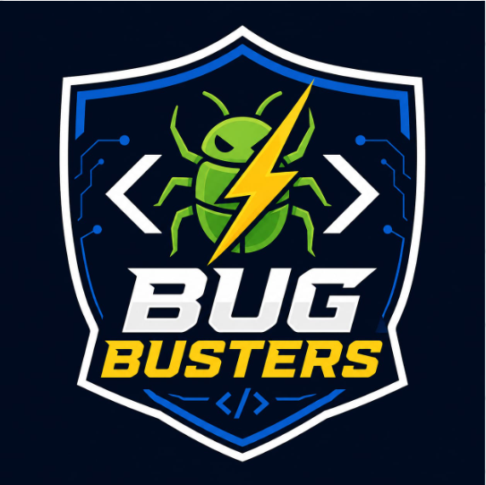

# Bug Busters — Team Promotional Website



**Design · Develop · Deliver**

A responsive team portfolio and promotional website introducing **Bug Busters**, a four-member student development team, and showcasing our featured project: **UK LogiWare**, an interactive workplace safety training system for warehouse and logistics environments.

> **Note:** This repository contains the **promotional website**, not the UK LogiWare training application. The portfolio runs independently and does not need a database or backend server.

## About the website

The website highlights who we are, what we do, how we worked together, and the project we developed. It provides an easy way for visitors, assessors and potential collaborators to explore our team's work.

### Features

- **Landing page:** Bug Busters branding and an introduction to our team.
- **About us:** Our approach to designing, developing and testing web applications.
- **Featured project:** A UK LogiWare overview with interactive **Explore**, **Practise** and **Progress** tabs.
- **Training topics:** Manual Handling, Working at Height and Cyber Awareness.
- **Our expertise:** UI/UX design, frontend development, backend and data, testing and documentation.
- **Project timeline:** Four development sprints, from authentication through final refinement.
- **Team section:** Member photographs, roles and expandable descriptions of contributions.
- **Connect section:** Links to the UK LogiWare project's GitHub repository.
- **Responsive navigation:** Layouts adapted for desktop, tablet and mobile screens.

**The feature previews describe the UK LogiWare system; the training simulations themselves are not implemented inside this promotional website.**

## Built with

The promotional website uses:

- **React 19** — user interface components and interactions
- **JavaScript (JSX)** — website logic
- **CSS** — layout, styling, responsive design and animations
- **Vite 8** — development server and production build

UK LogiWare, the **separate featured project**, uses the MERN stack (MongoDB, Express, React and Node.js).

## Getting started

### Requirements

- [Node.js](https://nodejs.org/) **20.19+ or 22.12+** (a recent supported version is recommended)
- npm (included with Node.js)
- A code editor such as Visual Studio Code

### Install and run locally

1. Clone this repository or download and extract the project ZIP.
2. Open a terminal **inside the folder containing `package.json`**.
3. Install dependencies:

   ```bash
   npm install
   ```

4. Start the development server:

   ```bash
   npm run dev
   ```

5. Open the local address shown in your terminal (typically `http://localhost:5173`).

### Production build

```bash
npm run build
```

The optimized static website will be created in the `dist/` folder.

To preview that build locally:

```bash
npm run preview
```

## Project structure

```text
Bug_Busters_Promotional_Website/
├── public/
│   └── favicon.svg           # Browser tab icon
├── src/
│   ├── assets/               # Team photos, logo and project images
│   ├── main.jsx              # React components, page content and interactions
│   └── styles.css            # Website styling and responsive layouts
├── index.html                # HTML entry point and page metadata
├── package.json              # Dependencies and npm scripts
├── package-lock.json         # Locked dependency versions
├── .gitignore                # Files excluded from Git (recommended)
└── README.md                 # Project documentation
```

## Our team

| Team member | Project role |
| --- | --- |
| **Sakar Gurung** | Scrum Master — sprint planning and team coordination |
| **Siddhartha Raj Subedi** | Backend & Frontend Developer — APIs, database, integration and implementation |
| **Anisha KC** | UI/UX & Frontend Developer — interface design and frontend development |
| **Sujan Shrestha** | QA & Documentation — testing, documentation and presentation support |

## Featured project: UK LogiWare

**UK LogiWare** is a workplace safety learning platform aimed at making warehouse training more interactive and engaging. Its showcased capabilities include:

- Administrator, trainer and trainee experiences
- Training programmes and learning sections
- 360° warehouse exploration and hazard hotspots
- Safety scenarios and level-based puzzles
- Quizzes, progress visibility and reporting

We developed the project over four sprints:

1. **Sprint 1 — Foundation:** Authentication, role-based access and dashboards.
2. **Sprint 2 — Learning:** Training programmes, learning sections and assignments.
3. **Sprint 3 — Interaction:** 360° exploration, puzzles and safety simulations.
4. **Sprint 4 — Delivery:** Progress and reporting, interface improvements and testing.

**UK LogiWare source code:** [siddarthasubedi1/Logistic_warehouse](https://github.com/siddarthasubedi1/Logistic_warehouse)

## Customization

- Edit the site text, team profiles and GitHub URL in `src/main.jsx`.
- Adjust the colors, typography, sections and mobile layouts in `src/styles.css`.
- Replace team photos and other visuals in `src/assets/`.
- Update the page title, description and social-sharing text in `index.html`.

**Important:** The website currently links to the **UK LogiWare project repository**. If you create a separate GitHub repository for this promotional website, update the links in `src/main.jsx` if you also want visitors to access the promotional site's source code.

## Deployment

This is a static frontend application. Run `npm run build`, then deploy the generated `dist/` folder to a static hosting platform such as Netlify or Vercel. No application server, database or environment variables are required for the website in its current form.

If you deploy to GitHub Pages under a repository subpath, configure Vite's `base` path for that repository before building.

## Before publishing to GitHub

- **Do not commit `node_modules/` or `dist/`.** Use the accompanying `.gitignore` file.
- Keep `package-lock.json` committed so dependencies can be reproduced.
- Verify the existing UK LogiWare repository link and all public-facing team details.
- Confirm you have permission to publish team photographs and other image assets.
- Add a LICENSE file if your team decides on an open-source license; none is assumed here.

---

**Bug Busters** — A student development team focused on turning ideas into useful digital experiences.
